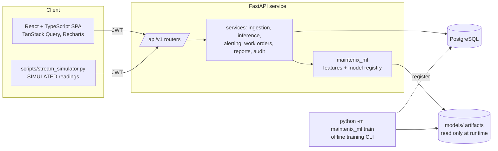
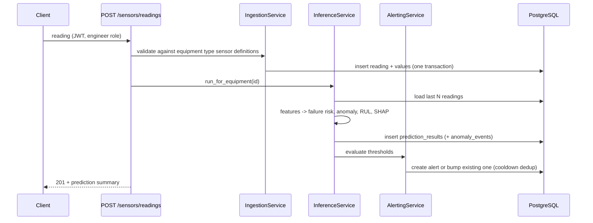

# Architecture

Maintenix AI is a modular monolith: one FastAPI service, one PostgreSQL database, one React single page app, and a separate `maintenix_ml` Python package that owns everything about data, features and models. There are no queues or extra services because nothing in the workload needs them yet (inference on one window takes milliseconds).

## Layers

| Layer | Location | Responsibility |
|---|---|---|
| Routers | `backend/app/api/v1/*.py` | HTTP, auth dependencies, request/response schemas, status codes |
| Schemas | `backend/app/schemas` | Pydantic contracts. ORM objects are never returned directly. |
| Services | `backend/app/services` | Business rules and transactions (ingestion, inference, alerting, work-order state machine, exports, audit) |
| Models | `backend/app/models` | SQLAlchemy 2.0 typed ORM |
| ML package | `ml/maintenix_ml` | simulator, validation, adapters, features, training, evaluation, explainability, registry |
| Frontend | `frontend/src` | pages, API client, hooks, reusable components |

## Request flow: a reading arrives

## Key design decisions

1. **Per equipment type models.** Pumps, motors and compressors have different sensors and failure physics, so every task (failure, anomaly, RUL) is trained per type and keyed in the registry by `(equipment_type, task)`.
2. **One feature implementation.** `maintenix_ml.features.build_window_features` is used by both training and the API.
3. **Backward looking windows only.** Every feature at time *t* uses readings at or before *t*, which removes temporal leakage by construction. Splits are by unit (trajectory), never by row.
4. **Artifacts are trusted only if produced by our pipeline.** The API loads joblib files only from `MODELS_DIR`, only if their SHA-256 matches the metadata written at train time, and only if the feature schema matches the running code. There is no upload endpoint for models.
5. **Advisory only.** Predictions create alerts and suggested actions. Nothing triggers a physical operation.
6. **Narrow sensor storage.** A `sensor_readings` row per (equipment, timestamp) plus `sensor_values` rows per sensor. Sensor sets are configured per equipment type in `sensor_definitions`.
7. **Synchronous inference.** Inference for one window is cheap, so it runs inline after ingestion. Batch/CSV ingestion runs it once on the latest window. A worker queue would be the next step at real scale (documented in `interview-guide.md`).

See `database-design.md`, `ml-methodology.md`, `api-guide.md` and `security.md` for detail.
