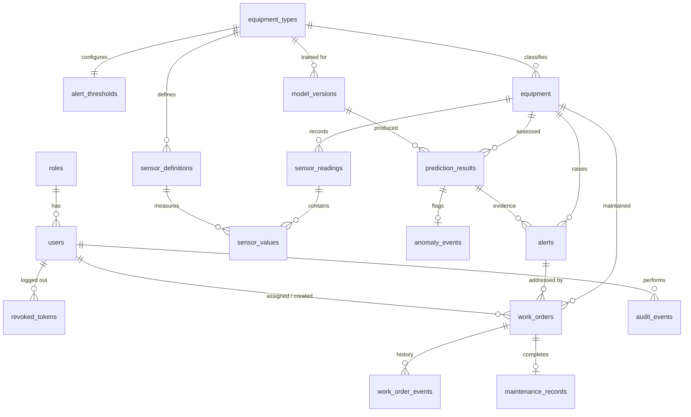

# Database Design

PostgreSQL 16, schema managed only by Alembic (`backend/alembic/versions`). A fresh database is fully initialised by `alembic upgrade head` followed by `python -m app.cli bootstrap`; no manual table edits are ever needed.

## Entity relationships

## Tables

| Table | Purpose | Key constraints |
|---|---|---|
| `roles` | admin, engineer, technician, viewer (seeded by migration) | unique name |
| `users` | accounts, bcrypt hash, active flag | unique email, `CHECK email = lower(email)` |
| `revoked_tokens` | JWT ids invalidated by logout, kept until expiry | PK jti, index on `expires_at` for pruning |
| `equipment_types` | catalogue synced from `maintenix_ml.equipment_types` | unique key |
| `sensor_definitions` | configurable sensor set per type with plausible and normal ranges | unique (type, name), `valid_min < valid_max` |
| `alert_thresholds` | per type warning / critical risk, anomaly override, cooldown | `0 < warning < critical ≤ 1`, cooldown 0 to 7 days |
| `equipment` | registered assets, operational status, data source, pointer to latest prediction | unique code, CHECKs on status, criticality, data source |
| `sensor_readings` | one row per (equipment, timestamp) with mode and operating hours | **unique (equipment_id, recorded_at)** for idempotent ingestion |
| `sensor_values` | one value per reading and sensor | PK (reading_id, sensor_id) |
| `model_versions` | registry mirror: version, metrics, feature schema, checksum, status | unique (type, task, version); **partial unique index: one `production` per (type, task)** |
| `prediction_results` | every assessment: probability, risk level, anomaly score, RUL, explanation | probability in [0, 1], CHECKs on statuses |
| `anomaly_events` | anomalous predictions with the sensors that deviated | one per prediction |
| `alerts` | deduplicated alerts | **partial unique index: one active (open or acknowledged) alert per (equipment, kind)** |
| `work_orders` | maintenance lifecycle | CHECKs: status set, completed ⇒ `completed_at`, assigned / in progress ⇒ assignee |
| `work_order_events` | status history (who, when, note) | FK cascade |
| `maintenance_records` | completion record (action, parts, downtime, restores health) | one per work order, downtime ≥ 0 |
| `audit_events` | sensitive actions with actor, entity, details, IP | indexed by time, actor, action |

Enumerations are `VARCHAR` with `CHECK` constraints rather than PostgreSQL enum types: adding a value is a one-line migration and does not need `ALTER TYPE`.

## Sensor storage and volume

A narrow layout (`sensor_readings` + `sensor_values`) keeps sensor sets configurable per equipment type without nullable columns or unbounded JSON. One hourly reading of a five sensor pump is 1 + 5 rows. The demo fleet (12 assets × 14 days) holds about 4,000 readings and 18,000 values.

| Index | Serves |
|---|---|
| `uq_sensor_readings_equipment_time` | duplicate prevention, `ON CONFLICT DO NOTHING` |
| `ix_sensor_readings_equipment_time_desc` (equipment_id, recorded_at DESC) | "last N readings" for inference, latest reading, ranges for charts |
| `ix_prediction_results_equipment_asof` | health history per equipment |
| `ix_alerts_status_last_seen` | active alert lists |

**Retention assumptions.** Raw readings are kept indefinitely in this project. At real scale (thousands of assets at 1 Hz) the next steps are: time-partition `sensor_readings` (or TimescaleDB hypertables with compression), keep raw data for a fixed window (for example 90 days) and keep hourly aggregates beyond it; predictions follow the same policy. JSONB columns (`explanation`, `sensor_deviations`, `metrics`, `details`) are bounded in size by construction (top 8 features, one entry per sensor).

## Transaction boundaries

| Operation | One transaction covers |
|---|---|
| Batch ingestion | validated readings and their values for one equipment (chunks of 1000 inside the same transaction) |
| Inference | prediction row, anomaly event, `equipment.latest_prediction_id`, alert create / update |
| Work-order transition | status change, event row, audit event, equipment status change, alert resolution |
| Model promotion | archive previous production, promote new, audit event |

Row locks (`SELECT … FOR UPDATE`) guard work-order transitions and active alert updates. The partial unique index on active alerts is the final guarantee against duplicate alerts from concurrent requests; the service retries as an update if it loses that race.

## Migration strategy

* Autogenerate from the SQLAlchemy models, then review by hand (the initial migration adds the circular `equipment → prediction_results` foreign key after both tables exist and seeds roles).
* `alembic check` runs in CI to fail if models and migrations drift.
* Tests build their schema with the real migrations on an empty database, so every test run exercises `upgrade head`. `downgrade base` was verified locally.
* The API container runs `alembic upgrade head` on start; with several replicas, run migrations as a separate one-off job instead.
