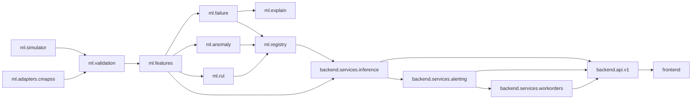

# Implementation Plan

## Workspace inspection (start of build)

| Item | Finding |
|---|---|
| Existing code | None. Fresh repository. |
| Python | 3.13 (venv at `.venv`) |
| Node | 22.x, npm 10.x |
| PostgreSQL | 16 server available locally (used for dev and tests) |
| Docker | Engine 29.x available (daemon started manually in the build sandbox) |
| NASA C-MAPSS | **Not downloadable from the build sandbox** (egress proxy returns 403). The adapter, preprocessing and RUL training path are implemented and unit tested against a tiny format fixture; real C-MAPSS metrics are *not* reported anywhere in this repo. |

## Smallest complete vertical slice

1. Simulator generates labelled run-to-failure trajectories for one equipment type.
2. `ml` trains a failure classifier + anomaly detector and writes a versioned artifact.
3. Backend loads the artifact, ingests a reading, computes window features, predicts risk, stores a prediction, raises an alert.
4. An engineer creates a work order from the alert, a technician completes it.
5. React dashboard shows all of it from API data.

Everything else (more equipment types, RUL, SHAP, reports, admin) widens that slice.

## Stages

| Stage | Scope | Exit criterion |
|---|---|---|
| 1 Plan | docs, skeleton, dependency map | this file + architecture.md |
| 2 Foundation | config, DB, Alembic, auth/RBAC, health, logging, errors | migrations apply on empty DB, auth tests pass |
| 3 Data & ML | simulator, validation, adapters, features, failure / anomaly / RUL, SHAP, registry, CLI | `python -m maintenix_ml.train` produces artifacts + metrics; ML unit tests pass |
| 4 Domain APIs | equipment, sensors, predictions, alerts, work orders, dashboard, reports, admin | API + integration tests pass |
| 5 Frontend | 11 pages wired to API | typecheck, unit tests, build pass |
| 6 Quality | lint, types, e2e (Playwright) | all suites green |
| 7 Delivery | Docker, Compose, CI, README, docs | `docker compose up --build` serves the app |
| 8 Verify | end-to-end smoke | smoke script passes against compose stack |

## Feature checklist

- [x] Admin-provisioned JWT auth with expiry and token revocation (logout)
- [x] Roles: admin, engineer, technician, viewer
- [x] Equipment types with configurable sensor definitions
- [x] Equipment CRUD + status changes + health history
- [x] Single, batch (JSON) and CSV sensor ingestion with row-level validation report
- [x] Simulated data generator (explicitly flagged `data_source = simulated`)
- [x] Per-equipment-type failure classifier (LogReg / RF / XGBoost compared, unit-grouped split)
- [x] Isolation Forest anomaly detector + per-sensor control limits
- [x] RUL regression for types with run-to-failure data; explicit "RUL unavailable" otherwise
- [x] C-MAPSS adapter + RUL training path (needs local dataset)
- [x] SHAP explanations for tree models, coefficient-based for linear
- [x] Model registry (filesystem artifacts + DB metadata, hash + feature schema check, promotion)
- [x] Alerts with cooldown deduplication and configurable thresholds
- [x] Work-order state machine with event history and completion records
- [x] Dashboard aggregates, CSV reports with formula-injection protection
- [x] Audit log for sensitive actions
- [x] Frontend: 11 pages, light/dark theme
- [x] Pytest, Vitest, Playwright, Docker Compose, GitHub Actions

## Dependency map

The backend imports `maintenix_ml` for feature computation and inference so that training and serving share exactly one feature implementation. Training code (`train.py`, model fitting) is never called by the API.
