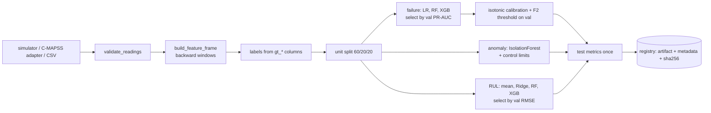

# ML Methodology

This page has two kinds of results. Sections 2 to 6 use the built-in **simulated** fleet. Section 9 uses the real **NASA C-MAPSS FD001** benchmark, the original public dataset, and those numbers are directly comparable with published work.

Simulated results come from `models/*/*/*/metadata.json` produced by

```bash
python -m maintenix_ml.train --models-dir models simulated --all      # seed 42
python -m maintenix_ml.evaluate --models-dir models                   # re-scores every artifact
```

They are measured on **simulated** data generated by `maintenix_ml.simulator`. They describe how well the pipeline recovers the degradation patterns the simulator encodes. They are **not** evidence of performance on physical equipment, and the simulator is cleaner than real plant data (one failure mode per type, Gaussian noise, no sensor drift or missing channels). Treat them as a correctness and methodology check.

## 1. Pipeline



| Module | Responsibility |
|---|---|
| `equipment_types.py` | sensor sets, plausible ranges, horizons, whether RUL is supported |
| `simulator.py` | deterministic synthetic trajectories (run to failure, intermittent faults) |
| `validation.py` | row level checks shared by training, CSV upload and the API |
| `adapters/` | `CanonicalCsvAdapter`, `CmapssAdapter` behind one `SensorDataAdapter` protocol |
| `features.py` | the only feature implementation, used by training **and** the API |
| `failure.py`, `anomaly.py`, `rul.py` | model families, selection, calibration |
| `evaluation.py` | unit split, threshold choice, classification, event and regression metrics |
| `explain.py` | per prediction SHAP style contributions |
| `registry.py` | versioned persistence, checksum and schema checks |
| `train.py`, `evaluate.py` | reproducible CLIs |
| `inference.py` | scoring one window for the API |

## 2. Data and labels

| Type | Units | Rows | Positive rate (failure within 48 h) |
|---|---|---|---|
| Centrifugal pump | 60 | 40,646 | 9.2 % |
| Electric motor | 60 | 48,182 | 7.7 % |
| Air compressor | 40 | 79,737 | 8.6 % |

* **Failure label**: 1 if a failure event happens within the type's horizon (48 h) after the reading. For the compressor, readings after the last observed trip whose horizon runs past the end of data are **censored** (label unknown) and dropped rather than labelled 0.
* **RUL target**: hours until failure, clipped at 200 h (125 cycles for C-MAPSS). Only run to failure types have one.
* Operating hours are deliberately excluded from features: cumulative hours carry no information about the current trajectory and would invite spurious age effects.

## 3. Features (FEATURE_VERSION 1.0.0)

Per sensor: last value, mean and std over 12 and 48 readings, min, max and least squares slope over 48, and the short minus long mean. Plus a one hot operating mode and the share of high load over 48 readings. Pump: 49 features; motor and compressor: 40.

**Leakage prevention by construction**

1. Every window ends at the current reading (`rolling(..., min_periods=w)` on time ordered data per unit), so no future values enter a feature. A unit test recomputes features on a truncated series and asserts they are identical.
2. Splits are by **unit**: a trajectory is wholly in train, validation or test. Row level random splits would put neighbouring, almost identical hours on both sides.
3. Model selection, calibration and the alert threshold use validation units only. Test units are scored once, after everything is fixed.
4. `gt_*` ground truth columns are never model inputs.

## 4. Failure risk classification

Candidates, all imbalance aware: Logistic Regression (standardised, balanced class weights), Random Forest (balanced subsample weights), XGBoost (`scale_pos_weight = negatives / positives`). Accuracy is never used: predicting "no failure" everywhere would score above 90 %.

Selection by **validation PR-AUC**, then **isotonic calibration** on validation scores so the displayed number behaves like a probability, then the **threshold that maximises F2** on validation (recall weighted twice as much as precision, because a missed failure costs unplanned downtime while a false alarm costs an inspection).

### Test results (held-out units)

| Type | Selected | Precision | Recall | F1 | PR-AUC | ROC-AUC | Brier | Threshold |
|---|---|---|---|---|---|---|---|---|
| Pump | Logistic Regression | 0.826 | 0.964 | 0.889 | 0.966 | 0.988 | 0.011 | 0.267 |
| Motor | Logistic Regression | 0.927 | 0.908 | 0.918 | 0.968 | 0.992 | 0.010 | 0.308 |
| Compressor | Logistic Regression | 0.659 | 0.757 | 0.704 | 0.797 | 0.920 | 0.029 | 0.152 |

Confusion matrices (test): pump TN 5545, FP 117, FN 21, TP 555; motor TN 6820, FP 41, FN 53, TP 523; compressor TN 11738, FP 452, FN 280, TP 872.

**Operational view.** Per reading recall understates usefulness: what matters is whether each failure was preceded by at least one warning.

| Type | Failure events in test | Warned in advance | Median first warning lead | False alarms per 1000 healthy hours |
|---|---|---|---|---|
| Pump | 12 | 12 | 47 h | 20.7 |
| Motor | 12 | 12 | 46 h | 6.0 |
| Compressor | 24 | 24 | 44 h | 37.1 |

**Candidate comparison** (validation PR-AUC → test PR-AUC): pump LR 0.974 → 0.966, RF 0.961 → 0.961, XGB 0.972 → 0.961; motor LR 0.972 → 0.968, RF 0.951 → 0.942, XGB 0.949 → 0.958; compressor LR 0.804 → 0.797, RF 0.783 → 0.779, XGB 0.792 → 0.778. A linear model wins because the simulator's degradation signal is close to monotone in the window statistics; real data with interacting failure modes would likely favour the tree models. The pipeline would pick them automatically.

**Calibration caveat.** Isotonic regression on a few thousand validation rows produces a step function that reaches exactly 0 and 1. The UI therefore shows ">99%" and "<1%" instead of claiming certainty.

## 5. Anomaly detection

An anomaly answers "is this unusual compared with healthy operation?", not "will it fail?".

* **Baseline data**: the first min(20 %, 150) readings of each training unit, which mirrors commissioning data. Simulator ground truth is not used to pick it.
* **Isolation Forest** (300 trees) on short window features. Score = `-score_samples`. Threshold = 99.5th percentile of scores on held-out baseline readings (about 0.5 % false alarms on healthy data by construction).
* **Control limits** per sensor and operating mode: baseline mean ± 4σ. They catch single sensor spikes that the multivariate forest dilutes, and they identify which sensor deviates.
* Decision: anomalous if the forest score is above threshold **or** any sensor is outside its limits. Admins can override the score threshold per type.

| Type | Injected spikes detected | IF only | Limits only | Flag rate, healthy | Flag rate, last 48 h before failure |
|---|---|---|---|---|---|
| Pump | 85.7 % (21 spikes) | 28.6 % | 85.7 % | 0.1 % | 100 % |
| Motor | 78.6 % (28) | 35.7 % | 78.6 % | 0.4 % | 100 % |
| Compressor | 92.5 % (53) | 3.8 % | 92.5 % | 1.9 % | 57.4 % |

Injected spikes are known only because the data is synthetic. On real equipment there is no such ground truth, so these flags are reviewed by people, and an anomaly alert explicitly says it is not a confirmed failure.

## 6. Remaining useful life

Only for types with run to failure data (pump, motor, C-MAPSS). The compressor and any type without a production RUL model show **"RUL unavailable"**; nothing is estimated.

Candidates: mean baseline, Ridge, Random Forest, XGBoost; selection by validation RMSE. Evaluation is regression evaluation (MAE, RMSE, bias), never classification metrics. Because the target is clipped, metrics are reported both over all test readings and over the readings where true RUL ≤ 200 h, which is where an estimate matters.

| Type | Selected | MAE (RUL ≤ 200 h) | RMSE (≤ 200 h) | Bias (≤ 200 h) | MAE, mean baseline (≤ 200 h) | MAE all readings |
|---|---|---|---|---|---|---|
| Pump | XGBoost | 24.9 h | 34.2 h | +16.7 h | 74.2 h | 10.9 h |
| Motor | XGBoost | 19.8 h | 27.5 h | +10.6 h | 77.8 h | 7.9 h |

**Limitations.** The models over estimate near failure (positive bias, 66 to 72 % of near failure predictions too high), which is the risky direction; the UI shows the typical error next to every estimate. A prediction at the cap means "at least 200 h". One simulated failure mode per type; real assets have several and RUL would need a model per mode or a survival model.

## 7. Explainability

* XGBoost: exact TreeSHAP from the booster (`pred_contribs=True`).
* Random Forest: `shap.TreeExplainer`.
* Logistic Regression: linear SHAP, `coef × (x − mean) / scale`, exact for a linear model under feature independence.

The API returns the top 8 feature contributions, contributions summed per sensor, the direction of each, and a limitations note. Contributions are in the raw output space of the **uncalibrated** model, relative to the training average. They show association, not causation; correlated features (for example `vibration__mean_48` and `vibration__max_48`) can share or swap credit.

## 8. Registry and reproducibility

* Artifact: `models/<type>/<task>/<version>/model.joblib`, plus `metadata.json` with dataset id (generator, unit count, seed, content fingerprint), split, feature schema and version, parameters, all metrics, library versions and the artifact SHA-256.
* The API loads only from `MODELS_DIR`, verifies the checksum and that the feature names and version match the running code. There is no model upload endpoint, because joblib files can execute code when loaded.
* One production model per (type, task) is enforced by a partial unique index. Promotion verifies the artifact loads first and archives the previous version.
* `python -m maintenix_ml.evaluate` regenerates each simulated dataset from its recorded seed and re-scores the stored artifact. All 8 registered models reproduced their stored test metrics exactly (tolerance 1e-6) when this documentation was written.
* Retraining is deterministic: retraining the motor models from scratch with seed 42 produced byte-identical test metric blocks and the same dataset fingerprint.

## 9. Real data: NASA C-MAPSS FD001

```bash
python scripts/download_cmapss.py --dest datasets/raw/cmapss      # SHA-256 verified
python -m maintenix_ml.train cmapss --data-dir datasets/raw/cmapss --subset FD001
```

FD001 is the original turbofan degradation dataset: 100 training engines run to failure (20,631 cycles), 100 test engines stopped early with their true remaining cycles in `RUL_FD001.txt`. The same pipeline is used unchanged: validation, the same backward window features on 14 informative sensors, a split of the 100 training engines into 60 / 20 / 20 by engine, model selection on validation engines. Failure horizon is 30 cycles; the RUL target is clipped at 125 cycles (the standard convention). Units below are **flight cycles**.

### RUL

| Evaluation | Engines | RMSE | MAE | Bias | NASA score |
|---|---|---|---|---|---|
| **Official test set** (last cycle of each test engine vs `RUL_FD001.txt`, true RUL clipped at 125) | **100 of 100** | **11.65** | 8.51 | +0.5 | 234.1 |
| Held-out training engines, readings with true RUL ≤ 125 | 20 | 10.10 | 7.25 | +1.8 | — |

Current model (feature version 1.1.0): XGBoost with depth 3, refitted on training plus validation engines after selection. See section 10 for how it was improved and what each change bought. For context, published FD001 results are commonly around 16 to 18 RMSE for classical regressors and around 12 to 13 for well tuned deep sequence models; this result was not tuned on the test set, but treat comparisons with care because papers differ in clipping and in how short engines are handled.

**Honest caveats.** The 125 cycle clip is applied to the ground truth as is standard. The official test score is a single prediction per engine (100 numbers), so it moves noticeably with small changes; the held-out trajectory metrics use about 2,500 predictions and are the steadier guide.

### Failure within 30 cycles

Selected XGBoost. Test engines: precision 0.941, recall 0.962, F1 0.951, PR-AUC 0.986, ROC-AUC 0.994. All 20 held-out failures were warned in advance, median first warning 29 cycles before failure, 12.3 false alarm readings per 1000 healthy cycles (previously 27.3).

### Anomaly

Baseline = first 20 % of cycles of each training engine. There is no injected ground truth in real data, so only the pre-failure flag rate (100 % in the last 30 cycles) is reported; degraded engines legitimately deviate from the healthy baseline, so many late-life test engines show "watch".

### In the application

`python -m app.cli import-cmapss --engines 8` loads eight official **test** engines (never used in training), spread across the range of true remaining life, as equipment `TF-xxx` with `data_source = imported`. Cycle k is stored at an hourly timestamp so the latest cycle is "now". The command prints the model estimate next to the ground truth; in this build:

| Engine | Cycles seen | True RUL | Predicted RUL (now) | Predicted RUL (before) | Failure prob. (30 cycles) |
|---|---|---|---|---|---|
| TF-034 | 203 | 7 | 5.2 | 7.6 | >99 % |
| TF-036 | 126 | 19 | 26.2 | 29.9 | 89 % |
| TF-052 | 189 | 29 | 27.4 | 31.3 | 11 % |
| TF-043 | 172 | 59 | 66.2 | 74.0 | <1 % |
| TF-093 | 244 | 85 | 52.7 | 52.3 | <1 % |
| TF-011 | 83 | 97 | 99.5 | 89.7 | <1 % |
| TF-088 | 68 | 115 | 117.1 | 108.5 | <1 % |
| TF-096 | 97 | 137 (125 clipped) | 114.0 | 120.2 | <1 % |

Mean absolute error over these eight engines fell from 10.0 to 8.2 cycles. TF-093 is the clearest miss (under estimate by about 33 cycles, the safe direction). This is what real model error looks like and why the UI always shows the typical error beside an estimate.

## 10. Improving the C-MAPSS model (feature version 1.1.0)

Rule followed: **every choice was made with 5-fold cross validation grouped by engine on the 100 training engines only** (`ml/experiments/cmapss_cv.py`, results in `ml/experiments/*.json`). The official test set was read once, after all choices were frozen, to report the final number.

### What was tried (CV RMSE on readings with true RUL < 125, lower is better)

| Step | Change | CV RMSE |
|---|---|---|
| Baseline | windows 12 / 48 readings, need 48 readings | 11.53 |
| Partial windows | long-window statistics from 30 readings (covers every test engine; shortest has 31 cycles) | 11.67 |
| + Age feature | `age__readings`, cycles since the record started (each C-MAPSS record starts with a new engine) | 10.96 |
| + Exponential smoothing | EWM means, spans 10 and 30 | 11.03 (no gain, dropped) |
| Window sizes | 12/64 → 10.26, **15/90 → 9.93**, 20/120 → 10.24 | 9.93 |
| Hyperparameters | 18 XGBoost settings (depth 3/4/6, learning rate and trees, min child weight) | **9.83** with depth 3 (range 9.83 to 10.06, so settings matter little) |
| Other models | Random Forest 10.56, Extra Trees 10.37, XGBoost + Extra Trees average 9.78 | ensemble gain 0.05 is noise; kept a single, explainable XGBoost |
| Refit | after selection, refit the chosen model on training + validation engines (80 instead of 60) | — |

### Before → after

| Metric | Before | After |
|---|---|---|
| CV RMSE, training engines, near failure | 11.53 | 9.83 |
| Held-out engines RMSE, near failure (≈2,500 predictions) | 12.16 | **10.10** (−17 %) |
| Held-out engines MAE, near failure | 8.69 | 7.25 |
| Official test engines covered | 95 | **100** |
| Official test RMSE, same 95 engines | 11.85 | 11.80 |
| Official test RMSE, all 100 engines | n/a | 11.65 |
| Failure model precision / F1 | 0.892 / 0.928 | 0.941 / 0.951 |
| False alarms per 1000 healthy cycles | 27.3 | 12.3 |

**Reading this honestly.** The improvement is clear on trajectory-level metrics and for the failure alarms (false alarms more than halved at the same recall). On the official last-cycle score the gain is within noise (11.85 → 11.80 on the same engines); the visible headline gain mostly comes from now covering all 100 engines. I did not iterate further against the official test set, because tuning on it would make the number meaningless.

**Why "age" is legitimate here but not for pumps.** In C-MAPSS every record starts with an engine entering service, so readings since record start is a real, observable quantity. For plant equipment the equivalent would be hours since the last overhaul, which the app tracks (`last_maintenance_at`) but the simulator does not model, so age stays off for those types. The feature is computed identically in training and in the API (the API passes the number of earlier readings as an offset; a unit test checks a 120-reading window with offset 80 matches the full-history features).

**Unchanged for the simulated types.** Pumps, motors and compressors keep their original windows; their failure and anomaly test metrics are byte-identical to the previous version. Their RUL models were refitted on training + validation units: pump near-failure MAE 24.9 → 22.9 h, motor 19.8 → 20.2 h (within noise).

**Upgrade path.** Feature version bumped to 1.1.0. On startup the API retires production models whose feature version no longer matches the running code and promotes the newest compatible version (tested on the dev database: 11 retired, 11 promoted).

### Still open

* RUL is still optimistic near failure (positive bias), the risky direction. Next: a quantile or asymmetric loss, or a bias correction fitted on validation engines.
* FD002 to FD004 (six operating conditions) need per condition normalisation.
